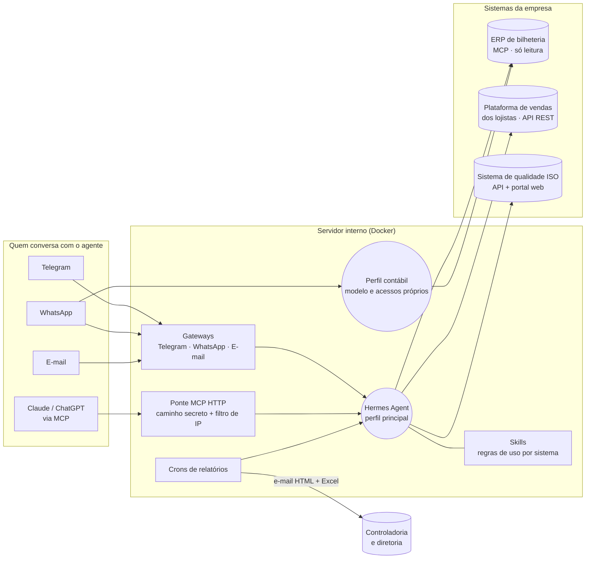

# Hermes Agent: arquitetura de um agente de IA para finanças e operações

> Estudo de caso de como montei um agente de IA ([Hermes Agent](https://github.com/NousResearch/hermes-agent), da Nous Research) que conversa com os sistemas de uma empresa de turismo e entretenimento, responde perguntas de diretoria e envia relatórios sozinho, **com acesso somente leitura por padrão**.
>
> *English summary at the bottom.*

Sou CFO, não desenvolvedor. Este repositório documenta as decisões de arquitetura, segurança e operação que tomei, com modelos reutilizáveis. Não há dados, credenciais nem endereços reais da empresa: nomes de sistemas foram trocados por categorias genéricas.

## Visão geral



## O que o agente faz

| Pergunta ou tarefa | De onde vem a resposta |
|---|---|
| "Quanto vendeu a atração X ontem?" | ERP de bilheteria (MCP) |
| "Quais lojistas não informaram vendas?" | API da plataforma de lojistas |
| "Como estamos na meta de EBITDA?" | Indicadores do sistema de qualidade ISO |
| "Me manda o procedimento de Compras" | Portal web do sistema ISO (download do documento oficial) |
| Relatório de visitação e receita 3x por semana | Cron → e-mail HTML com planilha anexa |
| Dúvidas contábeis da equipe | Perfil contábil, com modelo próprio e só o ERP |

## Princípios de arquitetura

1. **Somente leitura por padrão.** Cada skill diz o que o agente pode ler e o que exige autorização explícita. Ferramentas de escrita são removidas da configuração, não apenas proibidas no texto. → [docs/seguranca.md](docs/seguranca.md)
2. **Um perfil por público.** O perfil contábil tem outro modelo, outra lista de usuários e só os acessos de que precisa.
3. **Skills como contrato.** Cada sistema tem uma skill com endpoints, regras e exemplos; o agente consulta a fonte certa antes de responder. → [templates/skills](templates/skills)
4. **Scripts determinísticos para o que é frágil.** Login em portal, download de documento e montagem de relatório rodam em scripts testados, que o agente chama. Ele não improvisa um navegador a cada vez.
5. **Segredos só no `.env` do servidor.** Nada de chave em chat, prompt ou repositório.
6. **Canais que as pessoas já usam.** Telegram, WhatsApp e e-mail, com lista de usuários permitidos por canal.

Detalhes em [docs/arquitetura.md](docs/arquitetura.md) e lições em [docs/licoes-aprendidas.md](docs/licoes-aprendidas.md).

## Estrutura do repositório

```
docs/
  arquitetura.md          componentes, perfis, canais e fluxos
  seguranca.md            modelo de ameaças e controles
  licoes-aprendidas.md    o que deu errado e como resolvi
templates/skills/
  api-somente-leitura/    skill para qualquer API REST em modo leitura
  roteamento-de-perguntas/ obriga o agente a consultar a fonte certa
  portal-web-sem-api/     skill para sistemas que só têm interface web
examples/
  .env.example            variáveis esperadas (sem valores)
  config.example.yaml     trechos de configuração do Hermes
  docker-compose.example.yml
bridge/
  mcp_bridge.py           ponte MCP para Claude/ChatGPT (experimental)
  start_bridge.sh
```

## Stack

Hermes Agent (Docker) · modelos via OpenAI Codex e OpenCode (DeepSeek) · MCP · Python · Playwright · Gmail IMAP/SMTP · Telegram e WhatsApp · túnel Cloudflare/ngrok.

---

## English summary

A case study of an AI agent (Nous Research's Hermes Agent) wired into a leisure company's ticketing ERP, tenant-sales platform and ISO quality system. It answers executive questions over Telegram, WhatsApp, email and Claude/ChatGPT (via an MCP bridge), and sends scheduled HTML reports. Key choices: read-only by default (write tools removed in config, not just forbidden in prompts), one profile per audience, skills as per-system contracts, deterministic scripts for brittle tasks, and secrets only in the server's `.env`. No company data or credentials are included.

## Licença

MIT. Veja [LICENSE](LICENSE).
