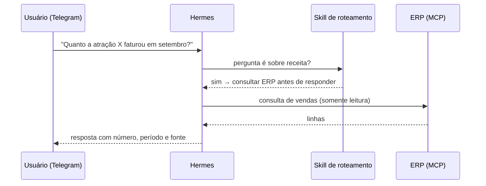

# Arquitetura

## 1. Onde roda

- **Hermes Agent em Docker** num servidor interno da empresa. Tudo que é persistente fica num único volume (`/opt/data`): configuração, `.env`, skills, scripts, perfis, logs e backups.
- Processos supervisionados (s6) para os gateways; processos auxiliares (ponte MCP, túnel) com script de inicialização idempotente.
- Atualização da imagem feita no host (`docker compose pull && docker compose up -d --force-recreate`), sempre com backup do volume antes.

## 2. Modelos

| Perfil | Modelo principal | Fallback | Por quê |
|---|---|---|---|
| Principal | Modelo de raciocínio via assinatura OpenAI Codex | DeepSeek (OpenCode) | Qualidade nas análises; fallback barato se a cota acabar |
| Contábil | DeepSeek via OpenCode (provedor compatível com OpenAI) | — | Em um teste com 4 casos contábeis com gabarito (Lucro Presumido, depreciação, receita diferida, EBITDA), três modelos acertaram 4/4; o DeepSeek foi ~3x mais rápido |

Lição: escolher modelo com **casos reais e gabarito**, não com impressão.

## 3. Perfis

Um perfil é uma instância isolada do agente: modelo, `.env`, skills, memória e lista de usuários próprios.

- **Principal**: acesso a todos os sistemas, canais Telegram, e-mail e a ponte MCP.
- **Contábil**: só o ERP (MCP), bot de Telegram e número de WhatsApp dedicados, lista de usuários da equipe contábil. Compartilha o token OAuth do MCP com o perfil principal por link simbólico, para não duplicar autorização.

## 4. Conexões com sistemas

| Sistema (genérico) | Como conecta | Regra |
|---|---|---|
| ERP de bilheteria | Servidor MCP com OAuth, escopo de leitura | Ferramenta de SQL de escrita removida via `tools.exclude` |
| Plataforma de vendas dos lojistas | API REST, token JWT renovado por login | Só GET; dados informados pelos lojistas nunca são alterados |
| Sistema de qualidade ISO | API (metadados) + portal web (valores e documentos) | GET por padrão; POST só com OK explícito após mostrar o JSON |

Quando a API não entrega o dado (o sistema ISO só expõe valores de indicadores na tela), um **script Playwright** com perfil de navegador persistente faz login, lê a página e devolve texto ou baixa o documento oficial. O agente chama o script; não abre navegador por conta própria.

## 5. Canais

- **Telegram**: canal principal, com lista de IDs permitidos.
- **WhatsApp**: número dedicado por perfil (modo bot), lista de números permitidos (com e sem o nono dígito).
- **E-mail**: conta própria do agente (IMAP/SMTP), lista de remetentes permitidos, assinatura em imagem.
- **Claude e ChatGPT**: via uma ponte MCP HTTP ([bridge/](../bridge)). Cada app tem um caminho secreto próprio e só é aceito vindo das faixas de IP publicadas pela Anthropic e pela OpenAI; o Claude também envia uma chave em cabeçalho.

## 6. Relatórios automáticos

Cron (seg/qua/sex) → o agente consulta o ERP → um script gera **um único e-mail HTML** com assunto padronizado, corpo fixo, assinatura e planilha anexa → destinatários em Para/Cc → falha avisa o dono por e-mail.

O envio nativo de cron por e-mail separava texto e anexo e não tinha assunto; por isso o envio passou para um script.

## 7. Fluxo de uma pergunta

